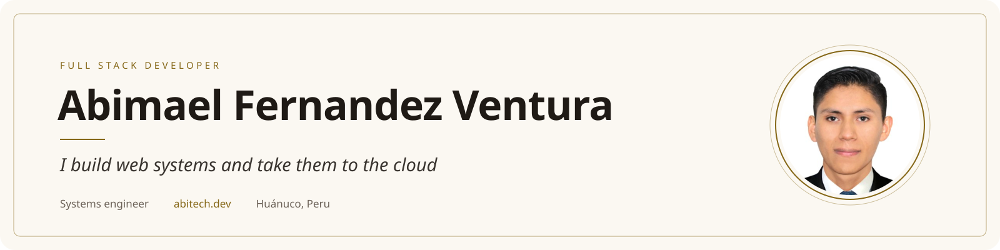
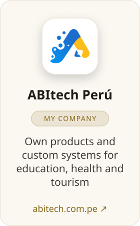
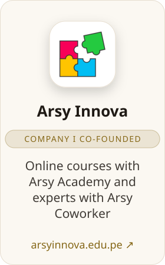
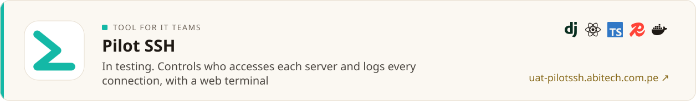
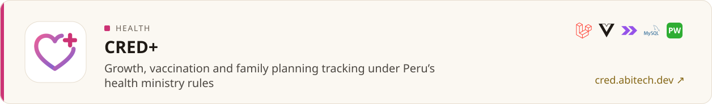

<picture><source media="(prefers-color-scheme: dark)" srcset="assets/en/banner-oscuro.svg"></picture>

<b>English</b> &nbsp;|&nbsp; <a href="README.md">Español</a>

<b>Full Stack Developer with Laravel, Vue, .NET and AWS</b> Full stack developer with a degree in Systems and Computer Engineering and 3+ years in web systems and integrations for Interbank and Scotiabank. I built Tu Coach UDH, a course platform with more than 8,900 users.

I work at Tecnovo Perú Soluciones. More about my background on <a href="https://abitech.dev">abitech.dev</a>

<b>3+</b> years of experience &emsp;&emsp; <b>15</b> systems in production &emsp;&emsp; <b>7</b> industries served

## What I do

<a href="https://abitech.com.pe"><picture><source media="(prefers-color-scheme: dark)" srcset="assets/en/iniciativa-abitech-peru-oscuro.svg"></picture></a>
<a href="https://arsyinnova.edu.pe"><picture><source media="(prefers-color-scheme: dark)" srcset="assets/en/iniciativa-arsy-innova-oscuro.svg"></picture></a>
<a href="https://github.com/abitech-dev/la-fruteria"><picture><source media="(prefers-color-scheme: dark)" srcset="assets/en/iniciativa-contenedores-con-peras-y-manzanas-oscuro.svg"></picture></a>

## Featured projects

<a href="https://uat-pilotssh.abitech.com.pe/"><picture><source media="(prefers-color-scheme: dark)" srcset="assets/en/proyecto-pilot-ssh-oscuro.svg"></picture></a>
<a href="https://cred.abitech.dev/"><picture><source media="(prefers-color-scheme: dark)" srcset="assets/en/proyecto-cred-oscuro.svg"></picture></a>
<a href="https://yachacuy.com/"><picture><source media="(prefers-color-scheme: dark)" srcset="assets/en/proyecto-yachakuy-oscuro.svg"></picture></a>
<a href="https://tucoach.udh.edu.pe/"><picture><source media="(prefers-color-scheme: dark)" srcset="assets/en/proyecto-tu-coach-udh-oscuro.svg"></picture></a>

## Open source

- [**abitech-payments-laravel**](https://github.com/abitech-dev/abitech-payments-laravel) &nbsp;Laravel package that integrates Stripe and Mercado Pago behind one interface
- [**abitech-antibot-laravel**](https://github.com/abitech-dev/abitech-antibot-laravel) &nbsp;Protects Laravel forms from bots with Turnstile or reCAPTCHA
- [**abitech-optipix-web**](https://github.com/ABItech-PERU/abitech-optipix-web) &nbsp;Custom Squoosh build that optimizes images in batches, without uploading them

## From the blog

- [The same Docker image from develop to production, without rebuilding](https://abitech.dev/en/blog/promover-la-imagen/)
- [Git Flow, GitHub Flow, GitLab Flow or trunk-based and how to choose](https://abitech.dev/en/blog/ramas-y-ambientes/)
- [How I sped up my site without a CDN, with the server in Europe](https://abitech.dev/en/blog/primer-byte-sin-cdn/)

<a href="https://abitech.dev/en/blog">All posts</a>

## Skills

| Area | Tech stack |
|:--|:--|
| **Backend** | PHP, Laravel, C#, .NET, Python, Django |
| **Frontend** | Vue.js, JavaScript, Inertia, Tailwind CSS, TypeScript, React |
| **Data** | MySQL, SQL Server, PostgreSQL, Redis |
| **Cloud and DevOps** | AWS, Terraform, Docker, GitHub Actions, Linux, NGINX |
| **Quality and integration** | Pest, Playwright, Mercado Pago |

## GitHub activity

<picture><source media="(prefers-color-scheme: dark)" srcset="assets/en/actividad-oscuro.svg"></picture>

## Let's talk

<b>Have a project in mind? <a href="mailto:abimaelfv@hotmail.com">Send me a message</a></b>

<a href="https://www.linkedin.com/in/abitechdev">LinkedIn</a> &nbsp;|&nbsp; <a href="mailto:abimaelfv@hotmail.com">Email</a> &nbsp;|&nbsp; <a href="https://abitech.dev">abitech.dev</a>

