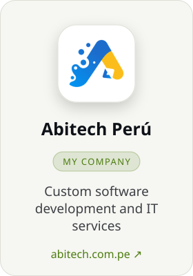
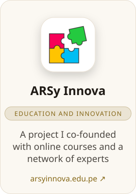
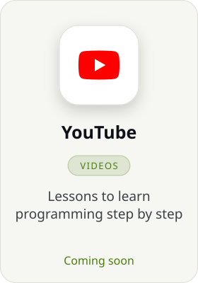
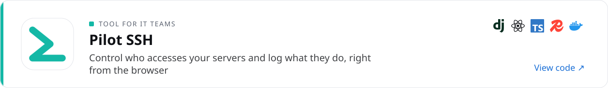
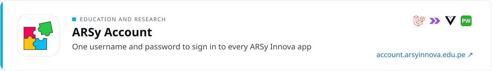
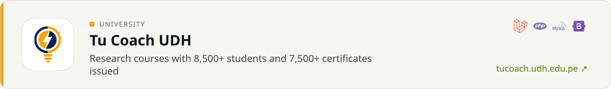

<picture><source media="(prefers-color-scheme: dark)" srcset="assets/en/banner-oscuro.svg"></picture>

<b>English</b> &nbsp;|&nbsp; <a href="README.md">Español</a>

<b>3+ years building systems that thousands of people use today</b> Course platforms with 8,500+ students, online stores with payments and custom management systems

I currently work as a full stack developer at Tecnovo Perú. More about my background on <a href="https://www.linkedin.com/in/abitech-dev">LinkedIn</a>

<b>35+</b> projects delivered &emsp;&emsp; <b>12</b> systems in use &emsp;&emsp; <b>6</b> industries served

## What I do

<a href="https://abitech.com.pe"><picture><source media="(prefers-color-scheme: dark)" srcset="assets/en/iniciativa-abitech-peru-oscuro.svg"></picture></a>
<a href="https://arsyinnova.edu.pe"><picture><source media="(prefers-color-scheme: dark)" srcset="assets/en/iniciativa-arsy-innova-oscuro.svg"></picture></a>
<a href="https://github.com/abitech-dev/la-fruteria"><picture><source media="(prefers-color-scheme: dark)" srcset="assets/en/iniciativa-contenedores-con-peras-y-manzanas-oscuro.svg"></picture></a>
<picture><source media="(prefers-color-scheme: dark)" srcset="assets/en/iniciativa-youtube-oscuro.svg"></picture>

## Featured projects

<a href="https://github.com/ABItech-PERU/pilot-ssh-web"><picture><source media="(prefers-color-scheme: dark)" srcset="assets/en/proyecto-pilot-ssh-oscuro.svg"></picture></a>
<a href="https://account.arsyinnova.edu.pe"><picture><source media="(prefers-color-scheme: dark)" srcset="assets/en/proyecto-arsy-account-oscuro.svg"></picture></a>
<a href="https://yachacuy.com"><picture><source media="(prefers-color-scheme: dark)" srcset="assets/en/proyecto-yachacuy-oscuro.svg"></picture></a>
<a href="https://tucoach.udh.edu.pe"><picture><source media="(prefers-color-scheme: dark)" srcset="assets/en/proyecto-tu-coach-udh-oscuro.svg"></picture></a>

## Open source

- [**abitech-payments-laravel**](https://github.com/abitech-dev/abitech-payments-laravel) &nbsp;Laravel package to accept several payment methods through one integration
- [**abitech-antibot-laravel**](https://github.com/abitech-dev/abitech-antibot-laravel) &nbsp;Protects Laravel forms from bots with Turnstile or reCAPTCHA
- [**inmuno-alerta**](https://github.com/ABItech-PERU/inmuno-alerta) &nbsp;Vaccination records with automatic email reminders
- [**abitech-optipix-web**](https://github.com/ABItech-PERU/abitech-optipix-web) &nbsp;Shrinks your images without uploading them anywhere, based on Squoosh

## Skills

| Area | Tech stack |
|:--|:--|
| **Backend** | PHP, Laravel, .NET, Django, Python, Node.js |
| **Frontend** | Vue.js, Inertia, React, Angular, TypeScript, Tailwind CSS |
| **Data** | MySQL, PostgreSQL, SQL Server, MongoDB, Redis |
| **Cloud and DevOps** | AWS, Terraform, Docker, GitHub Actions, Linux, NGINX |
| **Quality and integration** | Pest, Vitest, Playwright, Bruno, Swagger, New Relic |

## GitHub activity

<picture><source media="(prefers-color-scheme: dark)" srcset="assets/en/actividad-oscuro.svg"></picture>

## Let's talk

<b>Have a project in mind or want to learn with me? <a href="mailto:abimaelfv@hotmail.com">Send me a message</a></b>

<a href="https://www.linkedin.com/in/abitech-dev">LinkedIn</a> &nbsp;|&nbsp; <a href="mailto:abimaelfv@hotmail.com">Email</a> &nbsp;|&nbsp; <a href="https://wa.me/51901231876">WhatsApp</a> &nbsp;|&nbsp; <a href="https://abitech.dev">abitech.dev</a>

