

<picture><source media="(prefers-color-scheme: dark)" srcset="assets/es/banner-oscuro.svg">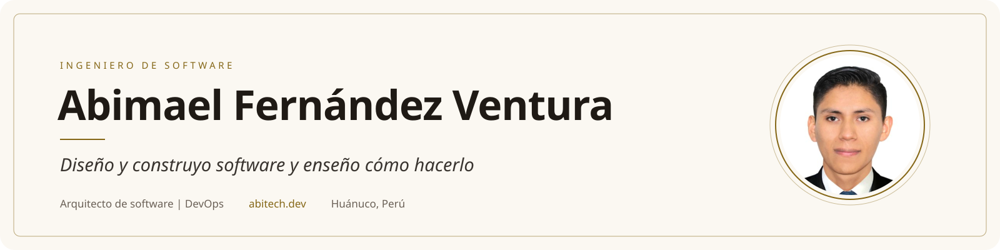</picture>

<a href="https://www.linkedin.com/in/abitech-dev"><picture><source media="(prefers-color-scheme: dark)" srcset="assets/es/boton-linkedin-oscuro.svg"></picture></a>&nbsp;<a href="mailto:abimaelfv@hotmail.com"><picture><source media="(prefers-color-scheme: dark)" srcset="assets/es/boton-correo-oscuro.svg"></picture></a>&nbsp;<a href="https://wa.me/51901231876"><picture><source media="(prefers-color-scheme: dark)" srcset="assets/es/boton-whatsapp-oscuro.svg"></picture></a>&nbsp;<a href="https://abitech.dev"><picture><source media="(prefers-color-scheme: dark)" srcset="assets/es/boton-web-oscuro.svg"></picture></a>

<b>Español</b> &nbsp;|&nbsp; <a href="README.en.md">English</a>

<b>Más de tres años creando sistemas que hoy usan miles de personas</b> Plataformas de cursos con más de 8500 estudiantes, tiendas con pagos en línea y sistemas de gestión a medida

Hoy trabajo como desarrollador full stack en Tecnovo Perú. Más sobre mi trayectoria en <a href="https://www.linkedin.com/in/abitech-dev">LinkedIn</a>

<picture><source media="(prefers-color-scheme: dark)" srcset="assets/es/cifras-oscuro.svg">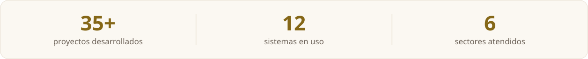</picture>

## Lo que hago

<a href="https://abitech.com.pe"><picture><source media="(prefers-color-scheme: dark)" srcset="assets/es/iniciativa-abitech-peru-oscuro.svg">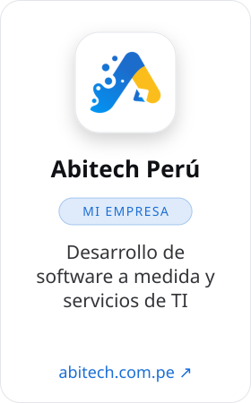</picture></a>
<a href="https://arsyinnova.edu.pe"><picture><source media="(prefers-color-scheme: dark)" srcset="assets/es/iniciativa-arsy-innova-oscuro.svg">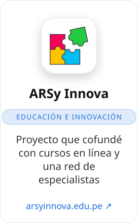</picture></a>
<a href="https://github.com/abitech-dev/la-fruteria"><picture><source media="(prefers-color-scheme: dark)" srcset="assets/es/iniciativa-contenedores-con-peras-y-manzanas-oscuro.svg">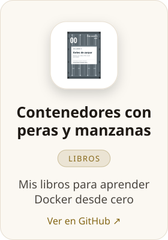</picture></a>
<picture><source media="(prefers-color-scheme: dark)" srcset="assets/es/iniciativa-youtube-oscuro.svg">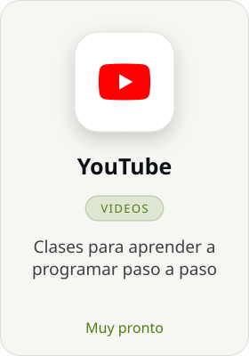</picture>

## Proyectos destacados

<a href="https://github.com/ABItech-PERU/pilot-ssh-web"><picture><source media="(prefers-color-scheme: dark)" srcset="assets/es/proyecto-pilot-ssh-oscuro.svg">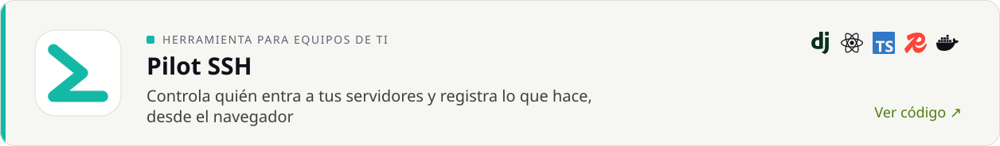</picture></a>
<a href="https://account.arsyinnova.edu.pe"><picture><source media="(prefers-color-scheme: dark)" srcset="assets/es/proyecto-arsy-account-oscuro.svg">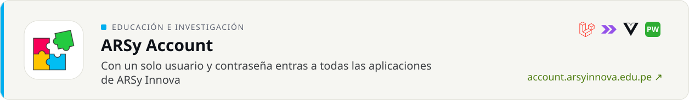</picture></a>
<a href="https://yachacuy.com"><picture><source media="(prefers-color-scheme: dark)" srcset="assets/es/proyecto-yachacuy-oscuro.svg">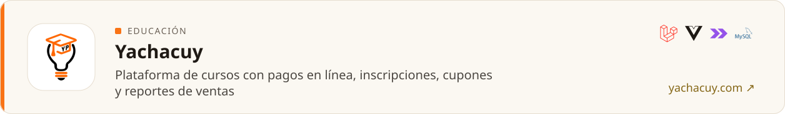</picture></a>
<a href="https://tucoach.udh.edu.pe"><picture><source media="(prefers-color-scheme: dark)" srcset="assets/es/proyecto-tu-coach-udh-oscuro.svg">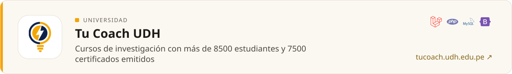</picture></a>

## Código abierto

<a href="https://github.com/abitech-dev/abitech-payments-laravel"><picture><source media="(prefers-color-scheme: dark)" srcset="assets/es/repo-abitech-payments-laravel-oscuro.svg">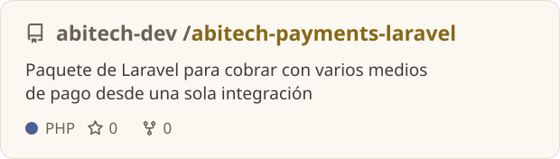</picture></a>
<a href="https://github.com/abitech-dev/abitech-antibot-laravel"><picture><source media="(prefers-color-scheme: dark)" srcset="assets/es/repo-abitech-antibot-laravel-oscuro.svg">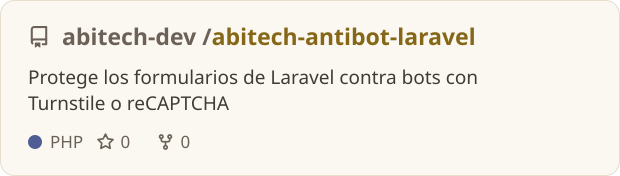</picture></a>
<a href="https://github.com/ABItech-PERU/inmuno-alerta"><picture><source media="(prefers-color-scheme: dark)" srcset="assets/es/repo-inmuno-alerta-oscuro.svg">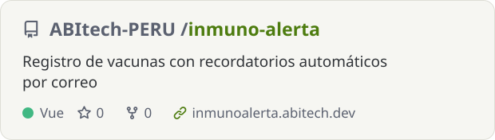</picture></a>
<a href="https://github.com/ABItech-PERU/abitech-optipix-web"><picture><source media="(prefers-color-scheme: dark)" srcset="assets/es/repo-abitech-optipix-web-oscuro.svg">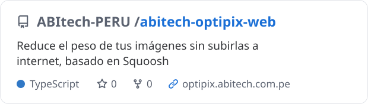</picture></a>

## Tecnologías

<picture><source media="(prefers-color-scheme: dark)" srcset="assets/es/stack-oscuro.svg"></picture>

## Actividad en GitHub

<picture><source media="(prefers-color-scheme: dark)" srcset="assets/es/actividad-oscuro.svg"></picture>

<b>¿Tienes un proyecto en mente o quieres aprender conmigo? <a href="mailto:abimaelfv@hotmail.com">Escríbeme</a></b>

