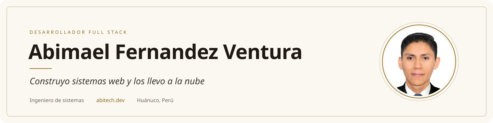
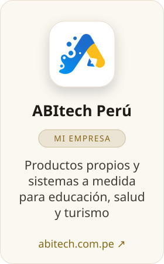
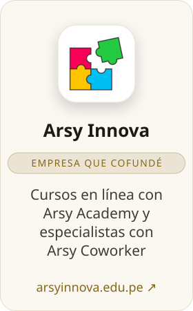
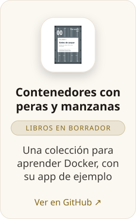
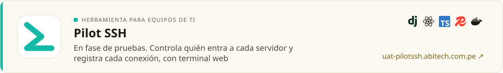
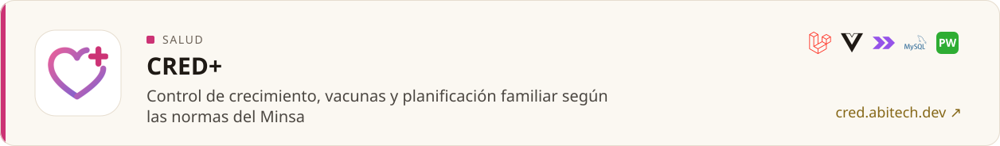
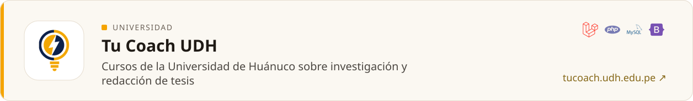

<picture><source media="(prefers-color-scheme: dark)" srcset="assets/es/banner-oscuro.svg"></picture>

<b>Español</b> &nbsp;|&nbsp; <a href="README.en.md">English</a>

<b>Desarrollador full stack con Laravel, Vue, .NET y AWS</b> Desarrollador full stack titulado en Ingeniería de Sistemas e Informática, con más de 3 años en sistemas web e integraciones para Interbank y Scotiabank. Desarrollé Tu Coach UDH, una plataforma de cursos con más de 8900 usuarios.

Trabajo en Tecnovo Perú Soluciones. Más sobre mi trayectoria en <a href="https://abitech.dev">abitech.dev</a>

<b>3+</b> años de experiencia &emsp;&emsp; <b>15</b> sistemas en producción &emsp;&emsp; <b>7</b> sectores atendidos

## Lo que hago

<a href="https://abitech.com.pe"><picture><source media="(prefers-color-scheme: dark)" srcset="assets/es/iniciativa-abitech-peru-oscuro.svg"></picture></a>
<a href="https://arsyinnova.edu.pe"><picture><source media="(prefers-color-scheme: dark)" srcset="assets/es/iniciativa-arsy-innova-oscuro.svg"></picture></a>
<a href="https://github.com/abitech-dev/la-fruteria"><picture><source media="(prefers-color-scheme: dark)" srcset="assets/es/iniciativa-contenedores-con-peras-y-manzanas-oscuro.svg"></picture></a>

## Proyectos destacados

<a href="https://uat-pilotssh.abitech.com.pe/"><picture><source media="(prefers-color-scheme: dark)" srcset="assets/es/proyecto-pilot-ssh-oscuro.svg"></picture></a>
<a href="https://cred.abitech.dev/"><picture><source media="(prefers-color-scheme: dark)" srcset="assets/es/proyecto-cred-oscuro.svg"></picture></a>
<a href="https://yachacuy.com/"><picture><source media="(prefers-color-scheme: dark)" srcset="assets/es/proyecto-yachakuy-oscuro.svg"></picture></a>
<a href="https://tucoach.udh.edu.pe/"><picture><source media="(prefers-color-scheme: dark)" srcset="assets/es/proyecto-tu-coach-udh-oscuro.svg"></picture></a>

## Código abierto

- [**abitech-payments-laravel**](https://github.com/abitech-dev/abitech-payments-laravel) &nbsp;Paquete de Laravel que integra Stripe y Mercado Pago con una sola interfaz
- [**abitech-antibot-laravel**](https://github.com/abitech-dev/abitech-antibot-laravel) &nbsp;Protege los formularios de Laravel contra bots con Turnstile o reCAPTCHA
- [**abitech-optipix-web**](https://github.com/ABItech-PERU/abitech-optipix-web) &nbsp;Versión propia de Squoosh que optimiza imágenes por lotes, sin subirlas a internet

## Del blog

- [La misma imagen Docker de develop a producción, sin reconstruirla](https://abitech.dev/blog/promover-la-imagen/)
- [Git Flow, GitHub Flow, GitLab Flow o trunk-based y cómo elegir](https://abitech.dev/blog/ramas-y-ambientes/)
- [Cómo aceleré mi sitio sin CDN con el servidor en Europa](https://abitech.dev/blog/primer-byte-sin-cdn/)

<a href="https://abitech.dev/blog">Todos los artículos</a>

## Competencias

| Área | Tecnologías |
|:--|:--|
| **Backend** | PHP, Laravel, C#, .NET, Python, Django |
| **Frontend** | Vue.js, JavaScript, Inertia, Tailwind CSS, TypeScript, React |
| **Datos** | MySQL, SQL Server, PostgreSQL, Redis |
| **Nube y DevOps** | AWS, Terraform, Docker, GitHub Actions, Linux, NGINX |
| **Calidad e integración** | Pest, Playwright, Mercado Pago |

## Actividad en GitHub

<picture><source media="(prefers-color-scheme: dark)" srcset="assets/es/actividad-oscuro.svg"></picture>

## Hablemos

<b>¿Tienes un proyecto en mente? <a href="mailto:abimaelfv@hotmail.com">Escríbeme</a></b>

<a href="https://www.linkedin.com/in/abitechdev">LinkedIn</a> &nbsp;|&nbsp; <a href="mailto:abimaelfv@hotmail.com">Correo</a> &nbsp;|&nbsp; <a href="https://abitech.dev">abitech.dev</a>

